     Activité 1-1 : Première connexion Client/Serveur 
   Étape 1 : Préparation de l’environnement Git 
version Git
Capture d'écran  :
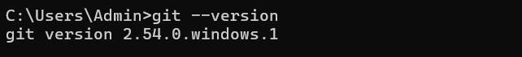

   Étape 2 : Préparation de l’environnement Java 
version Java
Capture d'écran  :
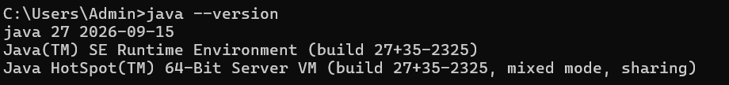

   Étape 3 : Création du serveur 

J'ai créé la classe Server dans le package serverPackage.

Le serveur ouvre le port 5000 et attend la connexion d'un client.

Capture d'écran  :
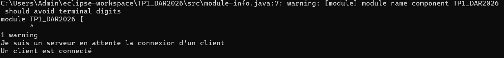

   Étape 4 : Création du client 

J'ai créé la classe Client dans le package clientPackage.

Le client se connecte au serveur en utilisant l'adresse localhost et le port 5000.

Capture d'écran  :
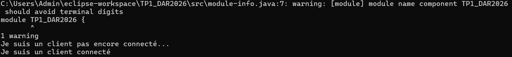

apres le changement de "localhost" par "mon ip " ne change rien 

    Activité 1-2 : Service de calculatrice
   Étape 2 : Création du service de multiplication 
3. 
x=5
Capture d'écran en Client :
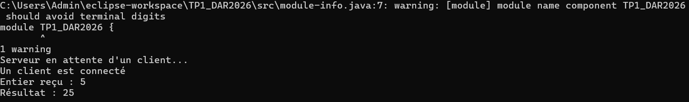

Capture d'écran en Server :

x=-5
Capture d'écran en Client :
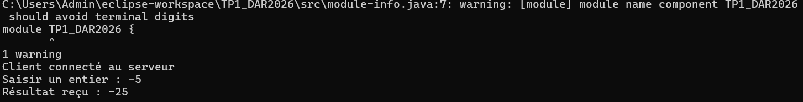

Capture d'écran en Server :
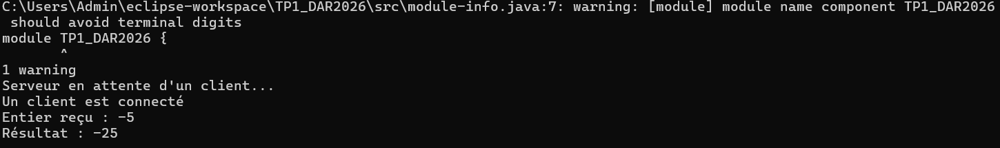

x=0
Capture d'écran en Client :
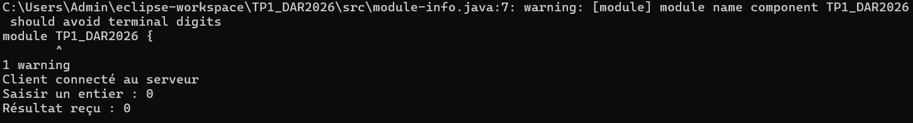

Capture d'écran en Server :
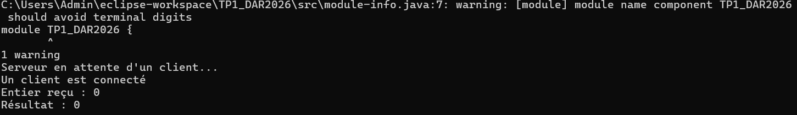

5.
Capture d'écran en Client :
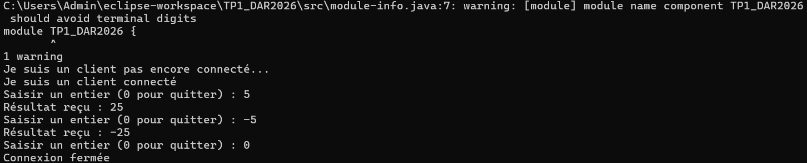

Capture d'écran en Server :
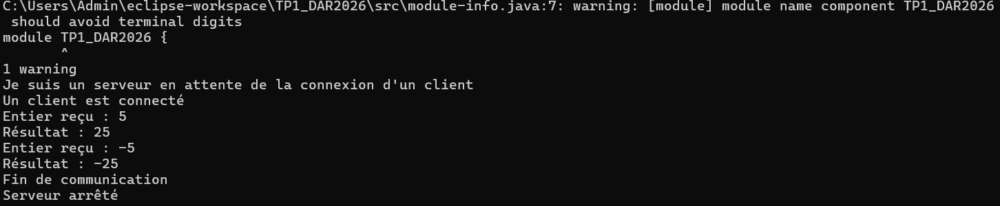

     Activité 1-3 : Première connexion Client/Serveur 
    Étape 1
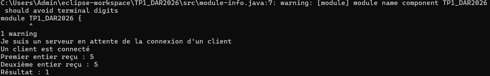

    Étape 2
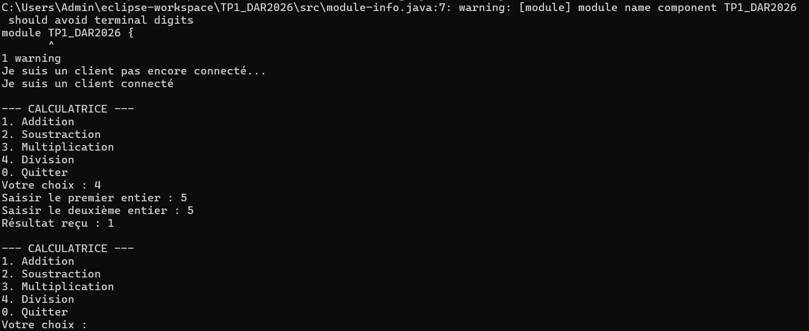
