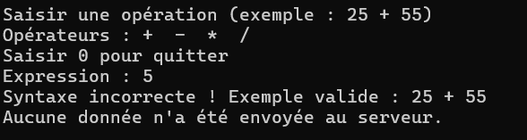
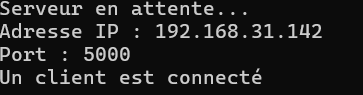
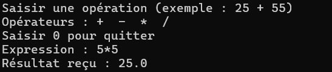
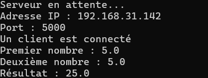
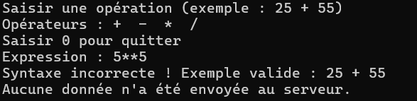
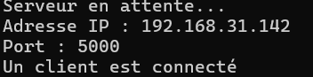
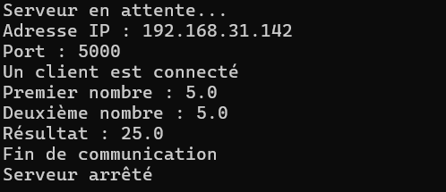
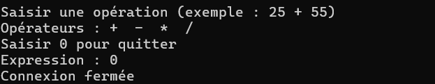

     Activité 2-1 : Échange de CC entre Client/Serveur via les Sockets TCP 
 
test

5

Capture d'écran en Client :

Capture d'écran en Server :

5*5

Capture d'écran en Client :

Capture d'écran en Server :

5**5

Capture d'écran en Client :

Capture d'écran en Server :

0

Capture d'écran en Client :

Capture d'écran en Server :

