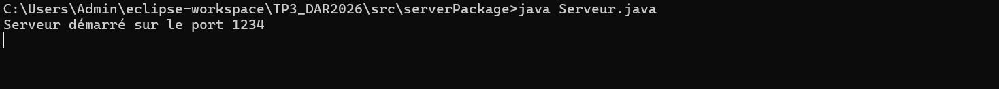

TP 3 : Serveur Multi-threads - sockets en mode connecté TCP 

    Activité 3-1 : Acceptation de plusieurs clients 
 
Les Test

Test avec clients Java

Capture d'écran en Client Java :

Test avec clients Telnet

Capture d'écran en Client Telnet :

